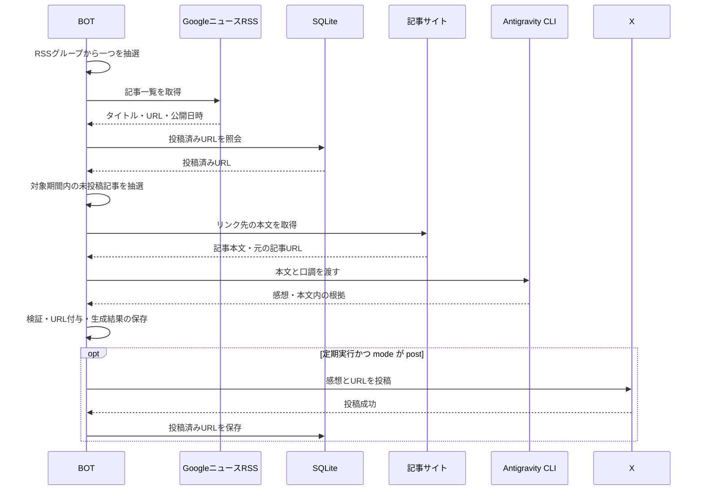

# shatotanBOT

GoogleニュースのRSSからランダムに記事を選び、本文を読んだ感想と記事URLをXへ投稿するBOT。
Docker内で常駐し、指定した時間帯の中で毎日実行時刻を抽選する。外部cronは不要。

現在はニュースの取得・本文確認・AIによる感想生成・定期実行・X投稿に対応する。
初期設定は **preview（生成のみ）**。天気投稿は今後の実装対象。

## 起動

Docker Composeと、ローカルPCで認証済みのLinux版Antigravity CLI（`agy`）を用意する。
ホストとコンテナのCPUアーキテクチャは一致している必要がある。

プロジェクトのルートで実行する：

```bash
mkdir -p src/data/agy-home/.gemini/antigravity-cli
docker compose up -d --build
docker compose logs -f bot
```

DockerfileでNode公式イメージにChromiumのOS依存パッケージを追加する。rootでの準備はイメージのビルド時に行う。
コンテナ起動時はホストと同じUID/GIDで `npm ci` とChromium本体の準備を行い、内部スケジューラーを起動する。
依存関係のインストール、AI CLI実行、テストはすべてDocker内で行う。
コンテナは `restart: unless-stopped` で復帰し、データはホストの `src/data/` に保持する。

### 実行ユーザーとファイルの所有者

BOTの実行ユーザーは初期値 `1000:1000`。このPCの `sheet` と同じUID/GIDなので、生成ファイルもホストでは `sheet` 所有になる。
コンテナ内のユーザー名が `node` と表示されても、ファイルの所有者は数値のUID/GIDで決まる。
`chmod 777` は不要。上のディレクトリ作成はホストの通常ユーザーで行い、認証マウント先の親ディレクトリを先に用意する。

別のUID/GIDで動かす場合は、プロジェクトルートの `.env`（X用の `src/.env` とは別）に指定する。

```dotenv
BOT_UID=1000
BOT_GID=1000
```

実際の値はホストで `id -u`、`id -g` を確認する。実行ユーザーやマウント設定の変更は `docker compose up -d --build` で反映する。

## ニュース生成を試す

```bash
docker compose exec -T bot npm start -- --news
```

ニュースを1件選び、本文に基づく感想とURLを画面に表示して `src/data/drafts/` に保存する。
`--news` は `mode: post` でもXへ投稿しない。定期実行の枠や投稿済みURLも消費しない。
失敗時は理由を記録し、終了コード1で終了する。

| コマンド（コンテナ内）                          | 動作                                                     |
| ----------------------------------------------- | -------------------------------------------------------- |
| `npm start`                                     | 内部スケジューラーを常駐起動                             |
| `npm start -- --news`                           | ニュース投稿文を1回生成して終了                          |
| `npm start -- --show-schedule`                  | 今日の抽選時刻・実行状態を表示。未抽選の枠は抽選して保存 |
| `npm start -- --help`                           | 起動オプションを表示                                     |
| `npm start -- --news --config /app/config.yaml` | 指定した設定で1回生成                                    |

## ニュース処理の仕様

1. RSSグループから一つのRSSを均等な確率でランダムに選ぶ。
2. 公開日時が対象期間内にあり、未投稿の記事から1件をランダムに選ぶ。初期の対象期間は過去72時間。
3. Chromiumで記事URLを開き、Googleニュースから元サイトへ移動して本文を抽出する。
4. 記事本文・タイトル・公開日時・口調をAntigravityへ渡し、本文に基づく短い感想を生成する。
5. 生成形式、本文内の根拠、Xの文字数制限を確認し、BOTが元の記事URLを付ける。
6. 生成結果を保存する。`mode: post` の定期実行ではXへ送信し、成功確認後に記事URLをSQLiteへ保存する。



投稿済みの判定にはRSS側のURLと元サイトのURLを使う。URLのフラグメントと一部の追跡パラメーターは除去する。
生成だけでは投稿済みにしないため、試運転では同じ記事が再び選ばれる場合がある。

未投稿記事がない、本文を取得できない、有料と判定された、本文が200文字未満または80,000文字超、生成失敗、検証不合格の場合は、その回を見送る。
別のRSSや記事を引き直して埋め合わせる処理は行わない。
本文中の根拠が存在するかを検証するが、感想全体の事実関係を自動で保証するものではない。

## 設定

[src/config.yaml](src/config.yaml) を編集し、再起動して反映する。

```bash
docker compose restart bot
```

```yaml
timezone: Asia/Tokyo
mode: preview
ai:
  provider: antigravity
  timeoutSeconds: 180
  tone: 親しみやすい自然な日本語。大げさにせず、記事を読んで気になった点を短く話す。
news:
  maxAgeHours: 72
  rss:
    # フード
    - https://news.google.com/rss/topics/CAAqIQgKIhtDQkFTRGdvSUwyMHZNREozWW0wU0FtcGhLQUFQAQ?hl=ja&gl=JP&ceid=JP%3Aja
    # 世界
    - https://news.google.com/rss/topics/CAAqJggKIiBDQkFTRWdvSUwyMHZNRGx1YlY4U0FtcGhHZ0pLVUNnQVAB?hl=ja&gl=JP&ceid=JP%3Aja
    # 日本
    - https://news.google.com/rss/topics/CAAqIQgKIhtDQkFTRGdvSUwyMHZNRE5mTTJRU0FtcGhLQUFQAQ?hl=ja&gl=JP&ceid=JP%3Aja
    # 科学＆テクノロジー
    - https://news.google.com/rss/topics/CAAqKAgKIiJDQkFTRXdvSkwyMHZNR1ptZHpWbUVnSnFZUm9DU2xBb0FBUAE?hl=ja&gl=JP&ceid=JP%3Aja
schedule:
  news:
    - id: lunch
      between: ["12:00", "14:00"]
      count: 1
```

RSSグループの初期登録は「フード」「世界」「日本」「科学＆テクノロジー」の4種類。
このGoogleニュースのトピックURLでは、`/topics/` を `/rss/topics/` に置き換えたURLをRSSとして使用する。
`ai.provider` は `antigravity` または `codex` を指定できる。初期構成の認証共有はAntigravity用で、Codexを使う場合はコンテナ内で別途認証する。
`ai.timeoutSeconds` は1〜300秒。設定ファイルは `--config` または `BOT_CONFIG` でも指定できる。

### ランダム時刻で各時間帯に1回実行

上の設定なら、毎日12:00〜14:00の間に1回実行する。今日は12:37、明日は13:18というように時刻が変わる。
複数回実行する場合は時間帯を追加する。

```yaml
schedule:
  news:
    - id: morning
      between: ["07:00", "09:00"]
      count: 1
    - id: lunch
      between: ["12:00", "14:00"]
      count: 1
    - id: evening
      between: ["18:00", "21:00"]
      count: 1
```

- 日本時間を使い、開始時刻以上・終了時刻未満から1分単位で抽選する。予定の確認間隔は15秒。
- 現在は `count: 1` に対応する。時間帯は同日内で、互いに重ならないよう指定する。
- 各枠の `id` は一意にする。同じ日・同じidの抽選結果はSQLiteに保存し、再起動しても引き直さない。
- 保存済みの予定は時刻設定を変更しても維持する。同日の再実行目的でidを変更しない。
- 枠の途中で初めて起動した場合は残り時間から抽選する。停止中に実行時刻を過ぎた予定は見送る。
- 処理開始済みの枠は、失敗やクラッシュ後も自動再試行しない。各枠で1回試み、失敗時の投稿数は0件になる。
- 定期実行と手動生成は共通のSQLiteロックを使い、同時実行を防ぐ。

## 自動投稿に切り替える

Xへの投稿はPlaywrightを使い、保存済みのログイン状態でブラウザから行う。
ログインが必要な場合は `src/.env` に次を設定する。

```dotenv
X_LOGIN_ID=ログイン用のメールアドレスまたはユーザー名
X_PASSWORD=パスワード
X_USERNAME=追加確認で使うユーザー名
```

```bash
docker compose exec bot npm run login
```

ログイン状態を `src/data/x-auth.json` に保存する。`X_USERNAME` はユーザー名による追加確認が必要な場合に使う。
投稿文を確認後、`src/config.yaml` の `mode` を `post` に変更して `docker compose restart bot` を実行する。
生成のみに戻す場合は `preview`、BOT全体を停止する場合は `docker compose down` を使う。

送信後に成功確認や履歴保存に失敗した場合は、再実行前にXとログで投稿の有無を確認する。

## Antigravityの認証共有

| ホストのファイル                                    | コンテナ内                                                           | 用途                                        |
| --------------------------------------------------- | -------------------------------------------------------------------- | ------------------------------------------- |
| `~/.local/bin/agy`                                  | `/usr/local/bin/agy`                                                 | CLI本体（読み取り専用）                     |
| `~/.gemini/antigravity-cli/antigravity-oauth-token` | `/app/data/agy-home/.gemini/antigravity-cli/antigravity-oauth-token` | OAuth認証（トークン更新のため書き込み可能） |

ホストのパスはCompose実行時の `HOME` から解決する。別のパスは `AGY_BIN`、`AGY_AUTH_FILE` で指定できる。
マウント元が存在しない場合は起動に失敗する。認証情報をリポジトリへコピーする必要はない。
CLIの設定・会話履歴・キャッシュはBOT専用の `src/data/agy-home/` に保存する。
BOTは標準入力に1件のJSONメッセージを渡し、Antigravityの最終結果から感想を受け取る。

## 保存データとテスト

| パス                      | 内容                                                           |
| ------------------------- | -------------------------------------------------------------- |
| `src/data/bot.sqlite`     | 抽選時刻・実行状態・投稿済みURL・実行ロック                    |
| `src/data/drafts/`        | 記事本文・参照URL・生成した投稿文                              |
| `src/data/x-auth.json`    | Xのログイン状態                                                |
| `src/data/errors.log`     | 手動起動などのエラー。定期処理の失敗はSQLiteとDockerログに記録 |
| `src/data/log/`           | ブラウザの解析ログ                                             |
| `src/data/agy-home/`      | BOT専用のAntigravityデータ                                     |
| `src/data/ms-playwright/` | Chromium本体                                                   |

```bash
docker compose exec -T bot npm run check
docker compose exec -T bot npm test
docker compose exec -T bot npm run smoke
```

自動テストは抽選の永続化、再実行防止、同時実行ロック、本文抽出、生成文検証、CLIの失敗・タイムアウト、`--news` の一連の動作を確認する。
テスト用CLIと記事を使い、AIサービスへの依頼やXへの投稿は行わない。`smoke` はChromiumとSQLiteの動作確認。

設計の背景は [コンセプト](doc/コンセプト.md)、開発環境の詳細は [開発環境](doc/開発環境.md) を参照。
