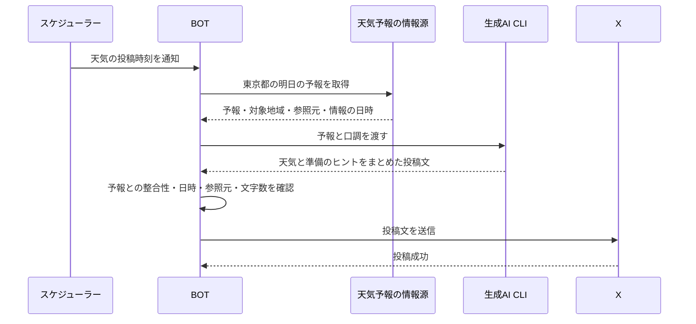
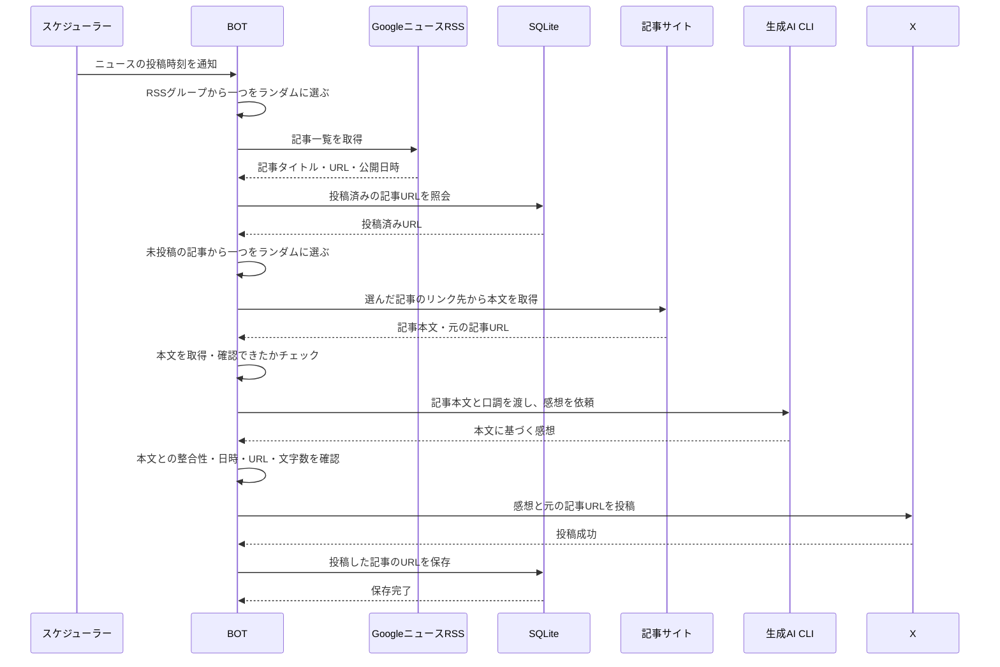

# shatotanBOT コンセプト

## 目指すもの

自分自身もフォローして、日々読みたくなる情報を届けるXの自動投稿BOT。
東京都の明日の天気など、生活に役立つ情報と、自分の興味に合った話題を発信する。
生成AIを使い、情報を読みやすくまとめたり、注目する理由を添えたりする。

投稿数を増やすことよりも、「見てよかった」「明日の準備に役立った」「面白い話を知れた」と思える発信を目指す。

## やりたいこと

- 生成AIで、Xに投稿する文章を作る。
- 東京都の明日の天気と、傘や服装などの準備のヒントを届ける。
- RSSグループからランダムに記事を選び、本文を読んだうえで感想と記事URLを投稿する。
- 指定した時間帯の中で実行時刻をランダムに決め、各枠で1回だけXへ自動投稿する。
- 発信するテーマ、口調、キャラクターを設定できるようにする。
- SQLiteに投稿済みの記事URLを保存し、同じ記事の重複投稿を防ぐ。

## 発信内容

- 明日の東京都の天気と、外出に向けた準備のヒント。
- 自分の興味のある分野のニュース、発見、豆知識。
- RSSから見つけた記事の本文に基づく感想と、元の記事へのリンク。

天気の対象地域は東京都とする。情報源はtenki.jp（`https://tenki.jp/forecast/3/`）とし、気象概況と東京都の明日の予報（天気・気温・降水確率など）を元にする。
明日の天気は夜に届ける案を基本とし、具体的な投稿時刻はこれから決める。

興味のある分野はこれから具体化する。旧版の購読先も候補の手がかりにしつつ、今の自分が読みたい内容を基準に選ぶ。

### ニュースの取得元

ニュース記事の収集にはGoogleニュースのRSSを使う。
購読するGoogleニュースのRSS URLの一覧を「RSSグループ」として設定する。
初期の購読先は、Googleニュースの「フード」「世界」「日本」「科学＆テクノロジー」のRSSとする。
各RSSのURLは [READMEの設定例](../README.md#設定) と `src/config.yaml` に記載する。今後、読みたい分野のRSSを追加する。

RSSグループに設定するURL例（フード）：

```text
https://news.google.com/rss/topics/CAAqIQgKIhtDQkFTRGdvSUwyMHZNREozWW0wU0FtcGhLQUFQAQ?hl=ja&gl=JP&ceid=JP%3Aja
```

GoogleニュースのトピックURLの `/topics/` を `/rss/topics/` に変更すると、対応するRSSのURLになる。

投稿ごとにRSSグループから一つのRSSをランダムに選び、そのRSS内の未投稿記事から一つをランダムに選ぶ。
RSSは記事を見つけるために使い、選んだ記事のリンク先から本文を取得して確認する。

## 生成AIの役割

天気予報やニュースの事実は外部の情報源から取得し、生成AIは文章の整理とコメントの作成を担う。
予報の数値や出来事を作り出さず、参照元と情報の日時を確認して発信する。
天気では、取得した予報に沿って傘や服装などのヒントを添える。
ニュースでは、取得した記事本文を読んで感想を作る。記事の事実とBOTの感想を区別し、感想に元の記事のURLを添えて投稿する。
タイトルやRSSの短い説明だけで、本文を読んだような感想を作らない。本文を取得・確認できない場合は、その回の投稿を見送る。

## 生成AIの呼び出し方

契約しているAntigravityまたはCodexをCLI経由で呼び出し、設定で切り替えられる構成とする。
Google側はGemini CLIではなく、Antigravity CLIを使う。

最初の実装ではAntigravity CLIを使い、ローカルPCのCLI本体とOAuth認証ファイルをDockerへマウントする。
CLIはDocker内で実行する。設定、会話履歴、キャッシュはBOT用に分け、認証ファイルだけを共有する。

- Antigravity CLI：`agy -p` による非対話実行。
- Codex CLI：`codex exec` による非対話実行。

BOTからAntigravityへ本文を渡す実装では、`--input-format stream-json --output-format stream-json` を使う。
標準入力に1件の依頼を渡し、最終結果を受け取って終了する。

BOTが天気や記事の情報を用意し、CLIに渡して投稿文を受け取る。
投稿文の検証、Xへの投稿、投稿履歴の管理はBOT側で行う。
生成AIの呼び出し部分を切り替えられるようにし、利用するサービスは設定で選ぶ。

実行環境でのログイン、契約に応じた利用枠、無人実行の動作を確認してから採用する。
生成に失敗した場合や利用上限に達した場合は、その回の投稿を見送り、理由を記録する。

参考：

- [Antigravity CLIの非対話実行](https://antigravity.google/docs/cli/headless/)
- [Codex CLIの非対話実行](https://learn.chatgpt.com/docs/non-interactive-mode)

## 基本の流れ

1. 投稿する時間になったら、天気予報や興味に合う話題を取得する。
2. 取得した情報をもとに、生成AIで投稿文を作る。
3. 情報の日時、参照元、文字数、内容、過去の投稿との重複を確認する。
4. Xへ投稿する。記事の投稿が成功したら、そのURLをSQLiteに保存する。

### 内部スケジューラー

Docker内でBOTを常駐させ、外部cronを使わずに実行する。
日本時間で時間帯を指定し、各枠の中から毎日実行時刻を1分単位で抽選する。終了時刻は抽選範囲に含めない。

現在の設定は、毎日9:00〜翌1:00を1時間ごとの16枠に分け、各枠でランダムな時刻に1回投稿する。1:00〜9:00は投稿しない。
23:00〜24:00と00:00〜01:00は別枠とし、0時枠はその時点の暦日の履歴に保存する。
全16枠は `src/config.yaml` を参照する。以下は設定の抜粋。

```yaml
timezone: Asia/Tokyo
schedule:
  news:
    - id: news_09
      between: ["09:00", "10:00"]
      count: 1
    - id: news_23
      between: ["23:00", "24:00"]
      count: 1
    - id: news_00
      between: ["00:00", "01:00"]
      count: 1
```

抽選時刻と実行状態をSQLiteに保存し、再起動しても引き直さない。
処理開始後の失敗やクラッシュでは同じ枠を自動で再実行せず、投稿の重複を避ける。
停止中に実行時刻を過ぎた予定は見送り、未抽選の枠の途中で初起動した場合は残り時間から抽選する。
各枠では1回の実行を試みる。情報取得や生成に失敗した場合、投稿は0件となる。

通常起動は内部スケジューラーを動かす。`npm start -- --news` はニュース処理、`npm start -- --weather` は天気処理で投稿文を1回生成して終了し、Xへの投稿は行わない。
天気処理はtenki.jpから気象概況と明日の東京都の予報を取得して生成する。

### 天気を投稿する流れ

夜の投稿時刻に、東京都の明日の天気を取得する。
天気投稿ではSQLiteを使わない。



### ニュース記事を投稿する流れ

ニュースの投稿時刻に、RSSグループから一つのGoogleニュースRSSをランダムに選ぶ。
投稿済みの記事を除外して、一つの記事をランダムに選び、リンク先の本文を取得する。
生成AIが本文に基づく感想を作り、BOTが感想と記事URLを投稿する。
投稿に成功した記事のURLをSQLiteに保存する。



### 両方に共通する動作

図は投稿に成功する場合の流れを示す。生成AI CLIには、設定で選んだAntigravityまたはCodexを使う。

- 試運転モードでは、検証後の投稿文を表示して終了する。Xへの投稿や投稿済みURLの保存は行わない。
- 情報取得や生成に失敗した場合、利用上限に達した場合、検証に不合格の場合は、投稿を見送り、理由を記録する。
- 未投稿のニュース記事がない場合も、投稿を見送り、理由を記録する。
- 記事本文を取得・確認できない場合は、投稿を見送り、理由を記録する。
- Xへの投稿に失敗した場合は理由を記録し、記事URLを投稿済みとして保存しない。

## 重複投稿の防止

SQLiteには投稿済みの記事URLを保存する。
記事を選ぶ際に投稿済みURLを除外し、生成AIによって文章が変わっても同じ記事を繰り返し投稿しない。
投稿が成功した記事のURLだけを保存する。

天気は1日1回の定期投稿とし、SQLiteでの重複管理は行わない。

## 最初に作る範囲

- 一つのXアカウントへの投稿。
- 東京都の明日の天気を紹介する投稿。
- GoogleニュースのRSSグループ（フード・世界・日本・科学＆テクノロジー）から記事を選び、本文に基づく感想とURLを投稿する。
- 設定したスケジュールでの自動投稿。
- 投稿前に生成文を確認できる試運転モード。
- 自動投稿の停止・再開と、失敗時の記録。
- SQLiteを使った重複投稿の防止。

## これから決めること

- 自分の興味のある分野と、取り上げたい話題・取り上げたくない話題。
- 東京都のどの地域を天気予報の対象にするか。
- BOTの名前、性格、口調。
- 運用する時間帯（実行方式は各枠で1回のランダム実行）。
- 使用する生成AIと運用予算。
- 天気予報の情報源と、RSSグループに追加する購読先。
- 実行環境と使用する言語。

## 旧版との関係

旧版は、ニュース・挨拶・天気・音楽などをTwitterへ投稿するPHP製BOT。
旧コードは `.idea/old/` に保管し、自動で話題を発信する発想を引き継ぎながら、Xと生成AIを使う構成へ作り直す。
